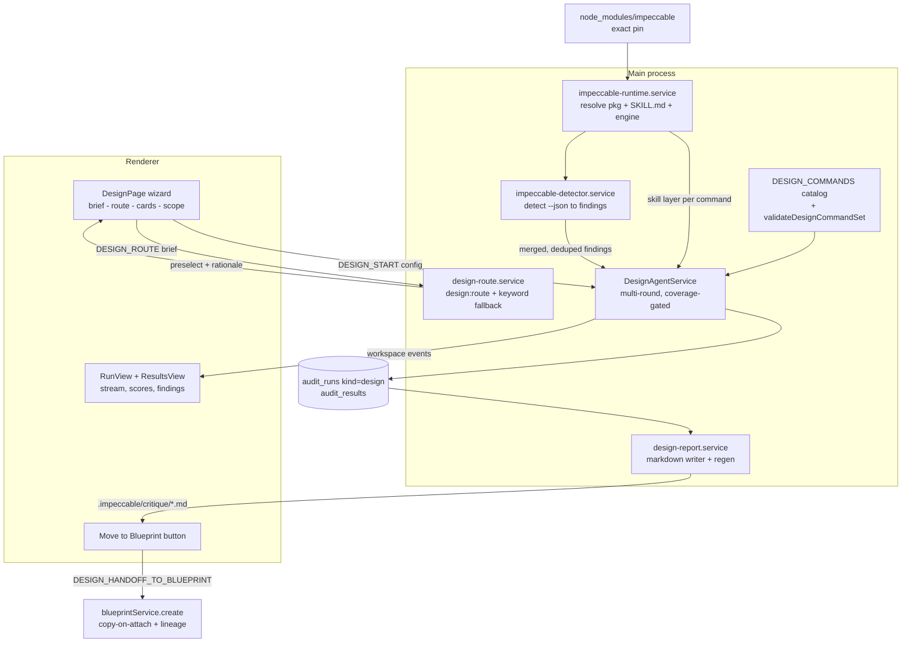

# Design Audit — Impeccable-Powered Design Review & Blueprint Handoff

> **Tracking file**: this document is the single source of truth for implementation status.
> **Status legend** — each item carries one of: `[ ] pending` → `[C] coded` → `[V] verified` (tests green) → `[A] audited` (reviewed by a second model/human). Update the status inline as you work. **Work strictly bullet-by-bullet; never start a phase with a prior phase below `[V]`.**
> **Intended execution**: this file is the input brief for a Code Atelier Blueprint run. Paste it (or attach it) as the blueprint description; SPECIFY/PLAN/TASKS decompose the phases below. Phases are ordered by build dependency, not by importance.

## Vision (context for any session picking this up)

Add an **Audit Design** capability parallel to the existing code audit (Workspace Health), powered by the [`impeccable`](https://github.com/pbakaus/impeccable) npm package (design skill pack: 1 skill, 23 commands, 61 deterministic detector rules, Apache-2.0):

- A **wizard** ("what do you want to accomplish") → LLM command preselection → Impeccable-style **command cards** (critique, audit, polish, harden, …) with a combination matrix that blocks nonsense pairs (`bolder`↔`quieter`, `distill`+additive passes) → **scope** selection (whole project vs pages/files).
- A design **run** executes **evaluate-class commands only** (`audit`, `critique`) as agent sessions with Impeccable SKILL.md guidance injected into the prompt, always merged with the **deterministic detector** (`impeccable detect --json`, zero LLM cost). Fix-class commands never execute here — they shape the remediation brief.
- On completion: a **findings report file** written to the workspace (`.impeccable/critique/`, Impeccable's own convention for tracked review artifacts) plus a DB mirror for history/restart.
- **Move to Blueprint**: one blueprint ingesting the report (attached via copy-on-attach) plus a **prefabricated remediation brief** encoding Impeccable's command routing (audit P0s→`harden`, theming/type→`polish`/`typeset`, perf→`optimize`, slop→`polish`/`distill`, copy→`clarify`), with lineage in `settingsJson`. Design-sourced blueprints inject the Impeccable skill layer into BUILD task prompts so fixes apply the same design vocabulary the audit used.
- A new **Design section** in the model configuration (3 role rows: Evaluate / Route / Init).

Integration model is **reference, not copy**: `impeccable` is an exact-pinned production dependency; its skill markdown is read at runtime and injected via the existing SkillPromptComposer pattern; the detector runs as a subprocess. Updates = bump the pin. (Internal tool; Apache-2.0; no license concern.)

## Decision ledger (resolved in interview)

| # | Topic | Decision |
|---|---|---|
| Q1 | Integration model | npm-managed package + prompt injection + detector CLI. No vendoring/copying. Exact pin (upstream ships multiple releases/week: 3.0→3.6 in ~3 months). |
| Q2 | Feature surface | Dedicated **DesignPage** (wizard UX diverges from track toggles) with its own `DESIGN_*` IPC namespace, but **shared audit storage**: `kind` discriminator (`'code' \| 'design'`) on `audit_runs` so AuditRepository, history, results, and handoff machinery are reused, not duplicated. *Alternative rejected: own `design_runs` tables (more migration code, duplicated retention/handoff for marginal isolation).* |
| Q3 | Command cards | 16 selectable commands (2 evaluate + 14 refine) in shared constants with an `incompatibleWith` matrix. Create/new-surface is **not** a card (out of scope). Multi-select = what runs now (evaluate) + what the blueprint brief gets told to do (refine route). |
| Q4 | INIT automation | `init` is interactive by design (interview writing PRODUCT.md) — **not a card, never auto-run**. It becomes an auto-**detected** wizard prerequisite: status chip (ready / missing / stale), one-click guided setup. `document` (DESIGN.md) is a pure code scan → runs unattended after init. Runs without context proceed with a degraded-quality warning. |
| Q5 | Scope | Wizard scope step: whole project vs selected files/dirs, filtered to design-relevant extensions. Default = detected UI source dir. |
| Q6 | Brief + LLM preselect | Step 1 free-text brief with prefabricated example chips. New `design:route` action (cheap model) maps brief → preselected commands + scope hint; deterministic keyword fallback when LLM unavailable. Preselect fills the card step; user confirms/edits. |
| Q7 | Wizard order | Brief → (LLM route in background) → command cards pre-filled & validated → scope → run. |
| Q8 | Model settings | New `design` ModelRoleGroup, 3 rows: **Evaluate** (`design:audit`), **Route** (`design:route`, haiku-class default), **Init** (`design:init`). |
| Q9 | Findings file | Written to `<workspace>/.impeccable/critique/YYYY-MM-DD-<commands>-<scope-slug>.md` (Impeccable's tracked-artifact convention — future `/impeccable` sessions discover it) + full result persisted in DB as source of truth (report regenerable). |
| Q10 | Execution engine | New `DesignAgentService` mirroring `AuditAgentService` (multi-round, coverage-gated `AgentSessionService` sessions); per-command Impeccable guidance as a prompt layer; detector runs for `audit` AND `critique` (Impeccable merges detector output into both) and its findings are deduped in. |
| Q12 | Skill provisioning | Impeccable's skill markdown is **not in the npm tarball** — it is materialised by the engine's `install` subcommand. We run that once into an **app-managed directory under `userData`** (`userData/impeccable-skill/`) and read from there. *Alternative rejected: installing into the user's workspace `.claude/skills/` — mutates their repo and dirties their git status without consent.* |
| Q11 | Move to Blueprint | ONE blueprint: description = prefabricated design-remediation brief (goal + command routing table + selected findings inline, severity-ordered); report attached as reference doc via **copy-on-attach** (durable against repo edits mid-pipeline; workspace-file no-copy is the rejected alternative); `settingsJson` = `{ source: 'design', sourceDesignRunId, commandIds, scope, reportPath }`. Mirrors `AUDIT_HANDOFF_TO_BLUEPRINT`. Design-sourced blueprints get skill injection into BUILD. |

## Resolved at implementation time (re-verify, do not trust memory)

- `CURRENT_SCHEMA_VERSION` in `src/main/db/index.ts` — memory values (85/94/100/120/147/157) are all stale records from different eras. Read it; the migration number for this feature is `CURRENT + 1`.
- Test runners: `src/main/services/__tests__/run-tests.ts` (unit) and `src/main/db/repositories/__tests__/run-tests.ts` (repo) are the executed entrypoints; `src/main/__tests__/run-all.ts` is the coverage aggregator with known drift. Register new tests in **both** run-tests.ts AND run-all.ts.
- Detector `--json` output schema (field names, severity level names) — undocumented in full; capture real output once and pin the mapper to it.
- Actual model IDs available in `AVAILABLE_MODELS` (memory disagrees: opus-4-7 vs opus-4-8, sonnet-4-6 vs sonnet-5) — use whatever the `audit` role defaults to as the Evaluate default.

## Verified grounding (seams this plan builds on)

- **Audit orchestration**: `src/main/services/audit-agent.service.ts` (890 lines — per-workspace state, sequential auditors, retry, events `progress`/`result`/`intermediate_findings`/`stream`/`complete`), `audit-coverage-tracker.ts`, `audit-response-parser.ts` (progressive ` ```audit-finding ` + ` ```audit-score ` blocks), `audit-prompt-templates.ts` (**has an unused `skillContent` param — wiring precedent**), `audit-discovery.service.ts`.
- **Audit storage**: `audit_runs` / `audit_results` / `audit_plans` / `audit_finding_handoffs` via `AuditRepository` (10-run retention, CASCADE, dynamic SET updates). `AuditFinding` = `{ id, severity: info|low|medium|high|critical, title, description, filePath?, recommendation? }` (`src/shared/types.ts` ~2287).
- **Blueprint intake**: `blueprintService.create({ workspaceId, title, description, priority, settingsJson })`; copy-on-attach at `src/main/ipc/blueprint.ipc.ts:82–128` (`userData/blueprint-docs/{ws}/{bp}/N-{filename}`, max 50 attachments, 25MB/file); reference docs budget-capped at **50K chars/file** in phase prompts (`blueprint-document-loader.ts:39`); format precedent `src/shared/audit-blueprint-format.ts` (`deriveBlueprintPriority`, `buildAuditBlueprintTitle`, `formatAuditFindingsBrief`); handoff handler precedent `AUDIT_HANDOFF_TO_BLUEPRINT` (`audit.ipc.ts:881–971`, `MAX_BLUEPRINT_FINDINGS = 50`, trusts DB not renderer payload, records envelope + handoff row).
- **Skill injection seam**: `SkillPromptComposer` (`skill-prompt-composer.ts`) — mtime-cached reads, budget tiers (minimal/standard/full, 4K hard cap), `buildBaselineSkillsLayer()` pattern, dev/packaged root split at :313 (`app.isPackaged ? userData : cwd`). Baseline skills live in `.claude/skills/{name}/SKILL.md`.
- **CLI probe pattern**: `runProbeAsync` in `blueprint-preflight.service.ts:313–355` (5s budget, parallel, never throws, Windows `.cmd` via `shell`, timeout ⇒ warn not blocker). `KNOWN_SERVICES` registry is the extension point.
- **Agent sessions**: `runAgenticClaude()` (`agentic-claude-runner.ts`) — `-p`, `--mcp-config`, `--allowedTools`, `--model`, `--max-turns`; **no `--skills` flag exists** — skill content must ride in the prompt.
- **Model config**: `ModelAction` union (`src/shared/types.ts:665`), `DEFAULT_MODEL_CONFIG` + `MODEL_ROLE_ROWS` + `MODEL_ROLE_GROUP_LABELS` (`src/shared/constants.ts:1025/1075/1206`), resolution via `resolveAssignment` (roles → overrides → defaults), optional-role off-binding (`OPTIONAL_MODEL_ROLE_ACTIONS`), UI `ModelRolesSection.tsx` (group sections via `rolesInGroup(group)`).
- **Page wiring**: `HealthPage.tsx` views `landing|configure|active|plan`; tab render in `WorkspaceSettingsContent.tsx:130+`; zustand precedent `audit.store.ts`; handoff hook `health/useAuditHandoff.ts`.
- **Packaging**: prod deps survive `npm prune --omit=dev` (`scripts/build-mac.sh:119+`); **`build/afterPack.js`** (registered at `electron-builder.yml:12`) prunes "non-essential assets" from copied node_modules (keeps `.js/.mjs/.cjs/.ts/.json`) — the impeccable payload is now explicitly whitelisted; `OnlyLoadAppFromAsar: false`.
- **Detector contract**: `impeccable detect --json <target>` — exit `0` clean / `2` findings / `1` failure; JSON on stdout, human output on stderr; honors `.impeccable/config.json` + inline `impeccable-disable` waivers; web files only (html/css/jsx/tsx/vue/svelte/astro/css-modules + configured template extensions); design-system checks unlock only when DESIGN.md exists; `--scope type|layout` domain narrowing available.

## Architecture



---

## P1 — Foundation: dependency, runtime resolver, provisioning, packaging

> **Status: `[C]` coded, unit-verified. ✅ The packaging/DMG gate PASSED (2026-09-07) — P3 is unblocked.**
>
> **Gate result** (`scripts/build-mac.sh`, run detached via `nohup` so no tool-level timeout could SIGKILL it past the EXIT trap; exit 0):
> - `codesign --verify --deep --strict` → **passed** (`✅ Signed and verified (team 25T7H2DCB3)`). This is the answer to premortem risk #1: **codesign does not reject the nested 12.7 MB vendor Mach-O.** `hardenedRuntime: false` / `notarize: false`, so the ad-hoc-signed vendor binary rides along inside the Developer ID signature without a separate entitlement.
> - DMG mounted → `Contents/Resources/app/node_modules/@impeccable/cli-darwin-arm64/bin/impeccable` present, mode 755, `Mach-O 64-bit executable arm64`, and **`--version` runs from inside the mounted bundle** → `4.0.0` (the engine's own version — see the "three version numbers" row). `node_modules/impeccable/package.json` also present.
> - The **P1.4 afterPack hard assertion did not fire**, which positively confirms `@impeccable/*` survives `npm prune --omit=dev` in a real build — previously only a dry-run claim (see the "Prune survival" row).
> - `node_modules` restored exactly by the EXIT trap: 68 `.bin` entries / 801 top-level packages, byte-identical to the pre-run snapshot; `npm ls impeccable` → `impeccable@4.0.4`.
>
> **Scope limit — what this gate did NOT prove.** P1.4's "launch the packaged app and repeat the dev smoke" is only *partially* discharged. Engine resolution is lazy: nothing calls `resolveEngineBinary()` at startup, and the only trigger is a design run, which needs P3. So this proves the payload **ships and survives codesign**; proving `app.getAppPath()` resolution *in-app* remains at **P7.3** ("run one design audit from the packaged app").
>
> **Operational note for whoever re-runs this:** the script runs `npm prune --omit=dev` against the shared tree and relies on an EXIT trap to restore it. A SIGKILL (or a backgrounded/timed-out invocation) skips the trap and leaves `node_modules` stripped. Always launch it detached. Recovery is `rm -rf node_modules && npm install --include=dev`.

### Ground truth captured during implementation (supersedes earlier guesses)

| Topic | Verified fact (engine v0.1.3 / npm 4.0.4, 2026-09-07) |
|---|---|
| Version | Latest npm is **`4.0.4`** (published 2026-09-06), not 3.6.1. Pinned exactly. |
| afterPack hook | Lives at **`build/afterPack.js`** (`electron-builder.yml:12`). `scripts/` has no afterPack. |
| Tarball contents | **No skill markdown at all.** 6 files: `cli/bin/cli.js` (4.3 KB launcher shim), `package.json`, `LICENSE`, `README*.md` × 3. |
| Real engine | Self-contained **12.7 MB Mach-O** in an `os`/`cpu`-gated optional dep: `@impeccable/cli-darwin-arm64@0.1.3` → `bin/impeccable`. **No Node required** — so we spawn it directly and sidestep the `RunAsNode: false` fuse. |
| Platform packages | `@impeccable/cli-{darwin,linux,windows}-{arm64,x64}` — note the OS token is **`windows`**, not node's `win32`; exe is `impeccable.exe` there. |
| Resolution tiers | Upstream order (`cli/bin/cli.js`): `$IMPECCABLE_BIN` → optional dep → **`$IMPECCABLE_HOME`/`~/.impeccable`/bin/**`<engineVersion>`**/** (version-partitioned, not flat) → download. |
| Three version numbers | npm pkg `4.0.4` · engine binary `0.1.3` (the optionalDependency range; its `--version` prints `4.0.0`) · skill content `4.2.2` (SKILL.md frontmatter). Do not conflate. |
| `install` flags | `-y`, `--providers=`, `--scope=project|global`, `--no-hooks`, `--force`. Fully non-interactive with `-y`; exits 0. |
| **`--scope=project` containment** | **Walks UP to the nearest `.git` and installs into that repo root — it ignores cwd.** Verified: running from `<repo>/nested/deep` wrote `<repo>/.claude`. Setting `cwd` is NOT containment. An empty `.git` dir planted at the provision root stops the walk. (This bit us: an early test run wrote into this repo.) |
| Install payload | `.claude/skills/impeccable/SKILL.md` (11.7 KB) + `reference/*.md` × 35 per-command playbooks (`audit` 7.9 KB, `critique` 42.7 KB — budget before injecting) + `scripts/command-metadata.json` (command catalog, useful for P2.1) + `scripts/` launchers + a duplicate 12 MB engine under `scripts/bin/<target>/`. Also `.claude/agents/impeccable-*.md` × 4. ~14 MB total. |
| Payload source | `install` **downloads** the skill payload — first provisioning needs network; offline → degrade path. |
| Prune survival | `@impeccable/*` survives `npm prune --omit=dev` (optional dep of a prod dep). Confirmed via dry-run. |

> ⚠️ **Environment trap:** this shell has `NODE_ENV=production`, which makes npm default to `omit=dev` — a bare `npm install <pkg>` silently removed all 828 dev packages. Always run `NODE_ENV=development npm install --include=dev` here.

- [C] **P1.1** `package.json`: `"impeccable": "4.0.4"` in **dependencies** (exact pin, like `better-sqlite3`). Installed layout verified: `node_modules/impeccable/cli/bin/cli.js`, `node_modules/@impeccable/cli-darwin-arm64/bin/impeccable` (12.7 MB, mode 755), `.bin/impeccable` + `.bin/impeccable-darwin-arm64`.
- [C] **P1.2** NEW `src/main/services/impeccable-runtime.service.ts` — sole owner of engine-path knowledge:
  - `resolvePlatformTarget()` — platform → `{ target, packageName, exeName }`, replicating the upstream mapping.
  - `resolveEngineBinary()` — 4-tier resolution above, `X_OK`-checked, memoised, returns the bare name as a PATH fallback; **never `npx`** (no Node guarantee in the packaged app).
  - `checkAvailability()` — `--version` probe, 5 s budget, memoised, shared in-flight promise, never throws.
  - `runEngine(args, opts)` — the only spawn point; 32 MB `maxBuffer` for `detect --json`; a non-zero exit is reported as a `code`, not an error (the detector uses exit 2 for "findings").
- [C] **P1.3** NEW `src/main/services/impeccable-provision.service.ts` — lazy, app-managed skill provisioning under `userData/impeccable-skill/`, stamp fast-path (`.provision-stamp.json`), single in-flight install, `.git` containment marker, mtime-cached `readSkillMarkdown()` / `readCommandMarkdown(id)` (the seam P3.2 injects into prompts), sync `getProvisionState()`.
- [C] **P1.4** `build/afterPack.js`: `PROTECTED_PATH_PATTERNS` short-circuits `prune()` for `node_modules/@impeccable/**` and `node_modules/impeccable/**`; post-copy **hard assertion** throws if `impeccable` is a prod dep but no `@impeccable/cli-*` engine is present/executable; the `strip -x` pass is documented as `.node`-only so the vendor Mach-O is never touched.
- [C] **P1.5** NEW `impeccable-runtime.test.ts` + `impeccable-provision.test.ts` (33 tests), registered in **both** `run-tests.ts` and `run-all.ts`.
  - Async bodies are wrapped in `runExclusive()` because they swap `process.env.IMPECCABLE_BIN`, and the harness starts every async test concurrently.
  - **No test may call `process.chdir()` or reassign `process.env.PATH`.** `runExclusive` only serialises against *other* `runExclusive` users, so a global mutation still corrupts the rest of the 271-file suite. The bundled-dependency tier is instead redirected with the `__setAppRootForTests()` seam, and the "engine unavailable" branch is driven by an engine whose `--version` exits non-zero rather than by emptying PATH.
- [C] **P1.6** (unplanned, root-cause fix) `src/main/services/__tests__/workspace-mcp-config-logic.test.ts` replaced the whole `require.cache` entry for `src/main/logger` with `{ chatAgentLogger }` and never restored it. Because it is registered at position 227 and never undone, **every** file loaded after it saw `skillLogger`/`dbLogger`/etc. as `undefined` — which is what actually made all 27 Impeccable tests fail in the aggregate run while passing standalone (`TypeError: Cannot read properties of undefined (reading 'info')`). The stub now spreads the real exports and overrides only `chatAgentLogger`. Two other test files (`memory-engine-pipeline-p26`, `memory-extract-body-p26`) carry comments describing this same "module-level `log` undefined" symptom, so this landmine had already cost time elsewhere. Both Impeccable services additionally route logging through an optional-call shim, since they promise never to throw.
- **Verify**: [V] `npm run typecheck` clean · [V] 33/33 Impeccable unit tests green **in the full 271-file `npm run test:unit` run** (12 909 passed / 5 failed; all 5 failures belong to unrelated pre-existing uncommitted WIP — `opencode-token-backstop`, `specialist-ingestion-gate`, `blueprint-session-resume`, `blueprint-preflight` login-shell env — and none are Impeccable) · [V] eslint clean · [V] dev smoke against the real engine (`available: true`, version `4.0.0`, SKILL.md 11 661 chars, `reference/{audit,critique,polish,harden}.md` all read, repo `git status` byte-identical before/after) · [V] **DMG gate PASSED** (2026-09-07): `scripts/build-mac.sh` exit 0, `codesign --verify --deep --strict` verified (team 25T7H2DCB3), DMG mounted and the engine confirmed present + executable (`Mach-O 64-bit executable arm64`) with `--version` → `4.0.0` from `Contents/Resources/app/node_modules/@impeccable/cli-darwin-arm64/bin/impeccable`; `node_modules` restored intact. In-app `app.getAppPath()` resolution still deferred to **P7.3** (needs a runnable design run, i.e. P3).

## P2 — Shared catalog, types, migration, model roles, IPC skeleton

> **Status: `[C]` coded, typecheck + unit + repo suites green.**
>
> **Deviations from the original P2 text, and why:**
> 1. The catalogue lives in a NEW `src/shared/design-commands.ts`, not in `constants.ts` — `constants.ts` is already 3.3k lines, and P2.2 explicitly allowed a dedicated module. Types stayed in `types.ts` as specified.
> 2. The catalogue is grounded in the engine's own `scripts/command-metadata.json` (23 commands) and the SKILL.md `argument-hint` families rather than invented. The plan's 16 map **exactly** onto Impeccable's own groupings: evaluate (audit, critique) · refine/amplify (animate, bolder, colorize, delight, layout, quieter, typeset) · simplify (adapt, clarify, distill) · harden (harden, onboard, optimize, polish).
> 3. **`overdrive` is the one refine command the plan omitted** — it is a real, non-deprecated command ("technically ambitious implementations"). It is excluded for now and documented as such in `design-commands.ts`; adding it later is a one-entry change. The other 6 engine commands (`shape`, `init`, `document`, `extract`, `live`, deprecated `craft`) are excluded per Q3/Q4.
> 4. Migration number is **160** (`CURRENT_SCHEMA_VERSION` was 159, not the stale 85/94/120 in memory).
> 5. Retention is now **per-kind**. The original text only mentioned filtering read paths, but `createRun`'s 10-run prune was workspace-scoped — unfiltered, a burst of design runs would have silently evicted the user's Workspace Health history. A test pins this.
> 6. `DESIGN_DELETE_RUN` verifies `kind === 'design'` before deleting, so the design page cannot delete a Health run by id.

- [C] **P2.1** `src/shared/design-commands.ts` (not constants.ts — see deviation 1): `DESIGN_COMMANDS: readonly DesignCommandDef[]` — 16 entries: evaluate (`audit`, `critique`) + refine (`polish`, `harden`, `optimize`, `distill`, `animate`, `typeset`, `layout`, `bolder`, `quieter`, `colorize`, `delight`, `adapt`, `clarify`, `onboard`). Each: `{ id, name, category: 'evaluate'|'refine'|'simplify'|'harden', description, impeccableCommand, incompatibleWith: DesignCommandId[] }`. Matrix per Impeccable's own philosophy: `bolder`↔`quieter` (two halves of voice, never neutral); `distill` vs additive (`animate`, `colorize`, `delight`, `bolder`); evaluate combines freely with everything. Plus `IMPECCABLE_DESIGN_EXTENSIONS` (html, css, jsx, tsx, vue, svelte, astro, mjs + css-module patterns) and `DESIGN_BRIEF_EXAMPLES` (chips: "I want to animate this user page", "Audit the current UX", "This page feels generic / AI-made", …).
- [C] **P2.2** Pure helpers in the same module: `validateDesignCommandSet(ids)` (conflicts normalised to catalogue order so a clash yields ONE badge, not two; unknown ids ignored so a stale id cannot mask a real conflict), `evaluateCommandsSelected(ids)`, `refineCommandsSelected(ids)`, `isDesignRelevantPath(p)`, `getDesignCommand(id)`.
- [C] **P2.3** `src/shared/types.ts`: `DesignCommandId` (union), `DesignRunConfig { commandIds, scope, brief, llmProvider? }`, `DesignContextStatus { productMd: boolean; designMd: boolean; stale: boolean }`; extend `ModelAction` with `'design:audit' | 'design:route' | 'design:init'`; extend `ModelRoleGroup` with `'design'`; `AuditFinding.source?: string` (`'impeccable-detector'` vs LLM).
- [C] **P2.4** `src/shared/constants.ts` — note `MODEL_ACTIONS_META` is a THIRD `Record<ModelAction, …>` the original text missed; all three must gain the new actions or typecheck fails. `DEFAULT_MODEL_CONFIG` += design actions (evaluate → same default as `audit` role; route/init → haiku/sonnet-class); `MODEL_ROLE_ROWS` += 3 design rows (Evaluate: actions `[design:audit]`; Route: `[design:route]`; Init: `[design:init]`); `MODEL_ROLE_GROUP_LABELS.design = 'Design'`; IPC channels `DESIGN_ROUTE`, `DESIGN_START`, `DESIGN_CANCEL`, `DESIGN_GET_LATEST`, `DESIGN_GET_HISTORY`, `DESIGN_DELETE_RUN`, `DESIGN_CONTEXT_STATUS`, `DESIGN_GENERATE_REPORT`, `DESIGN_HANDOFF_TO_BLUEPRINT` (namespace `design:*`).
- [C] **P2.5** Migration **160**: `ALTER TABLE audit_runs ADD COLUMN kind TEXT NOT NULL DEFAULT 'code'` + index on `(workspace_id, kind)`. Sweep `AuditRepository` read paths to filter `kind = 'code'` (Health) — existing flows must be untouched.
- [C] **P2.6** NEW `src/main/ipc/design.ipc.ts` — read paths (`GET_LATEST`/`GET_HISTORY`/`DELETE_RUN`) are fully functional and kind-scoped; execution channels validate eagerly and return a structured `{ ok: false, reason }` until P3 rather than throwing. `parseDesignRunConfig` re-enforces the incompatibility matrix in main, so an out-of-date renderer cannot start a contradictory run. — skeleton with `requireObject/requireString` validation mirroring audit.ipc.ts; register in `src/main/ipc/index.ts` `registerAllIpcHandlers()` (currently 49 modules).
- [C] **P2.7** Tests: NEW `src/main/services/__tests__/design-commands.test.ts` (31 tests — catalogue integrity incl. symmetry of the matrix, every conflict pair, partitioning, extension helpers), registered in `run-tests.ts` + `run-all.ts`; `kind` round-trip, per-kind history/latest isolation and per-kind retention appended to the existing `audit.repository.test.ts` (already registered in the repo runner).
- **Verify**: [V] `npm run typecheck` + eslint clean · [V] `npm run test:repo` **612 passed / 0 failed** · [V] `npm run test:unit` **12 938 passed / 7 failed**, and every design + impeccable suite executed and passed. Of the 7:
  - **1 was a real regression from this phase and is fixed** — `model-roles-assignment.test.ts` asserted "covers all five groups"; adding the `design` group made it six. Renamed and updated. (Grepped for other group-count assumptions: none.)
  - 3 are load-flakiness (`blueprint-preflight` ×2, `blueprint-build-deep-phase25`) — all pass standalone on an unloaded machine (42/42 and 53/53).
  - 3 are pre-existing and unrelated (`infers_dotnet_and_csharp_from_cs_files`, `resume / rotation / flag-off / stale`, and a login-shell env probe), present in the baseline run before any of this work.
- [V] Health **e2e** regression — **resolved as scoped.** NEW `e2e/health-kind-smoke.e2e.ts` passes (`--workers=1`, 0 skipped).
  - **Why the seven existing `health-*` specs gave no signal:** they run against the *real* developer profile. `e2e/helpers/electron-fixture.ts:120` only creates a throwaway `E2E_USER_DATA` when `CLAUDE_SHIM_DIR` is set; without it the app boots into `~/Library/Application Support/…`, every workspace directory on the machine is missing, `ensureWorkspaceReady()` returns `false`, and every test calls `test.skip()`. They were green and proved nothing.
  - The new spec seeds its own workspace over IPC under `CLAUDE_SHIM_DIR` — the pattern already used by `blueprint-dag-scheduling`, `blueprint-quality-gates` and `workspace-switch-streaming` — then asserts the Audit Code landing view renders (`health-page` + `health-landing`) and that `auditGetHistory` → `[]` and `auditGetLatest` → `null` resolve without throwing. That exercises the kind-scoped read paths through the real renderer → preload → IPC → repository → SQLite stack.
  - Two harness details worth keeping: run with **`--workers=1`** (parallel workers contend over the CDP endpoint and the fixture fails to attach — a harness limit, not an assertion), and the spec must **navigate Home before clicking the workspace card**, because after the renderer reload the app restores the most recent workspace and boots straight into it, so no card list is on screen. Cards are matched by `data-workspace-id`, never by name.
  - **What it explicitly does NOT prove: design-vs-code isolation.** `DESIGN_START` returns `notImplemented` until P3.1 and no `DESIGN_*` channel reaches the preload until P4.6, so there is no way to create a `kind='design'` row from a running app today. The real kind-discriminator sweep stays at **P7.2**; it is not claimed here.
- **Verify (e2e)**: [V] `npm run typecheck:e2e` adds **0** new errors (37 pre-existing, none audit/design/health-related).

### P2.8 — Hardening pass (unplanned, landed after P2.7)

Shipped in response to the premortem; each item is defensive, none change the P2 surface.

- [C] **Schema hygiene** on the migration-160 `kind` work.
- [C] **Target-aware packaging assertion** in `build/afterPack.js` — the presence check now compares against the *target* platform's `@impeccable/cli-<target>` package rather than assuming the host's. On a `darwin/arm64` host expected == present, so it is a no-op for local builds and only bites on a genuinely broken cross-target payload. **It ran clean during the P1.4 gate.**
- [C] **Path + length validation** in `design.ipc.ts`, with NEW `src/main/services/__tests__/design-ipc.test.ts`.
- [C] **`AuditTrackId` widened** to admit `design:<commandId>`. This is the wall P3.1 would otherwise have hit on day one — one `audit_results` row per command is only representable because of this.
- [C] **Failure TTL + provisioning cooldown** in `impeccable-provision.service.ts`, so a failed (e.g. offline) install degrades rather than retrying hot.
- [C] **`DesignIpcResult` envelope** — the structured `{ ok: false, reason }` shape the execution channels return until P3 wires them up.

- [C] **P2.8b** (unplanned, latent production bug found while unblocking the build) `src/main/services/blueprint-lead-review.service.ts` used three **relative `require()`s** inside `enqueueMemoryExtraction`, wrapped in a `try/catch` that only warns. Rollup copies those through verbatim, so in the packaged app the first one threw `MODULE_NOT_FOUND`, the catch swallowed it, and **blueprint memory extraction was silently dead on the lead-review completion path.** Converted to static ESM imports, matching `blueprint-verify.service.ts` — the file lead-review's own comment says it mirrors, and which already imports the same three modules statically. No cycle: lead-review is imported by exactly one file (`blueprint.ipc.ts`) and `memoryExtractionService` is already in the main bundle via `src/main/index.ts`. The three now-dead entries were removed from `BASELINE` in `scripts/verify-build-assets.mjs` (7 baselined offenders → 4). `index -> ../db/repositories` **stays** — `code-graph.service`, `chat-stream.service` and `resolve-workspace-name` each still emit it.
  - **Verify**: [V] the 6 eslint `require()` errors on the file are gone (2 pre-existing `no-empty-function` errors remain, part of the repo-wide 114-error backlog — not touched) · [V] `npm run typecheck` clean · [V] `npm run build` passes `verify-build-assets` with no stale-baseline note · [V] `grep -c 'require("./memory-extraction.service")' out/main/index.js` → `0` · [V] `npm run test:unit` **13 038 passed / 2 failed**, both confirmed pre-existing (`specialist-ingestion-gate` fails identically with the change stashed; `blueprint-session-resume` passes standalone — a suite-ordering flake).
  - **Note for a follow-up ticket:** six other files carry the same class of latent bug and are still baselined (`code-graph.service` ×2, `chat-stream.service`, `resolve-workspace-name`, `blueprint.service -> ./blueprint-spec.service`). Out of scope here.

## P3 — Execution engine

> **Status: `[C]` coded, typecheck + eslint + unit green.**

### Ground truth captured in the P3.0 spike (supersedes the P3 guesses)

Run against the real engine, scanning real repo files. Nothing was written to the repo.

| Topic | Verified fact (engine v0.1.3, 2026-09-07) |
|---|---|
| Top-level JSON | A **bare array** `[ {...} ]` on **stdout** — *not* an envelope object. Empty scan → `[]`. Human-readable text goes to stderr. |
| Keys | `antipattern`, `name`, `description`, `severity`, `category`, `file`, `line`, `snippet`, optional `importedBy`, optional `advisory`. |
| `file` | **Absolute path.** Relativized at the mapper boundary — see correction 1. |
| `line` | **`0` means file-level**, not line zero (e.g. `em-dash-overuse`). Never rendered as `:0`. |
| Exit codes | `0` clean · `1` a target could not be scanned · `2` findings present. Confirmed empirically. |
| **Advisory findings** | **RESOLVED: they DO appear in `--json`, and they ARE distinguishable — twice over** (`severity: "advisory"` *and* a dedicated `advisory: true` field). Per the decision rule fixed in advance, they are **included and mapped to `info`**, not suppressed with `--no-advisory`. An advisory-only scan still exits `0`, which is why exit `0` must be parsed rather than short-circuited. |
| Observed severities | `warning`, `advisory`. |
| Observed categories | `slop` **and `quality`** — the P3 text claimed `slop` only. |
| Full enum | Still **not enumerable** (packed binary, no rule-catalog command), hence the defensive severity map with `unknown → medium` logged once per run. |

### Deviations from the P3 text, and why

1. **NEW `design-discovery.service.ts`** (unplanned). P3.1 assumed the audit discovery could be reused, but `discoverAuditableFiles` selects by *track* via a fixed pattern config and its walker is not exported. Design selects by *user-chosen scope*. Separate module, same skip-list and caps.
2. **NEW `role-adapters/design.adapter.ts`** (implied but not itemised). It reuses **`role: 'audit'`** rather than adding a `'design'` `AgentRole`: a new role would make `resolveModelAction` derive a non-existent `'design:plan'` action and silently fall back. Sharing a role across adapters is already established here — four blueprint adapters share `'blueprint-review'`. The model is still routed through the dedicated `design:audit` action, so the Design rows in model settings control it.
3. **Prompt assembly strips sections, it does not merely truncate.** Roughly half of `critique.md` and a third of `audit.md` tell the agent to run the `scripts/impeccable` launcher, write a report in Impeccable's format, persist a snapshot, and ask the user questions. Those conflict with our read-only, single-shot, `audit-finding` contract — this is a **correctness** filter, not a budget one. `Assessment B: Detector + Browser Evidence` is dropped for the same reason: it points at `.claude/skills/impeccable/scripts/impeccable detect` (a path we do not ship into the user's workspace) and at browser automation the session does not have. We run the detector ourselves and inject its output instead.
   - **Measured against the real payload:** all 16 command layers land under the 8 000-char cap, worst case **7 776**. `audit` retains its full five-dimension Diagnostic Scan; `critique` (42.7 KB raw) retains Purpose, Hard Invariants, Assessment A and the Cognitive Load reference material.
4. **`AuditRun.designConfig`** added as a typed field over the existing `selected_skills` column (no migration). P3.1 said to reuse that column for `{ brief, scope }`; surfacing it as `selectedSkills` would have been a lie, since the two populations are disjoint by `kind`.
5. **Fallback when no evaluate command is selected.** Refine cards never execute, so a selection of only refine cards would have produced a run with zero result rows. `resolveExecutableCommands` falls back to `critique` and the refine cards shape its prompt.
6. **Detector findings attach to the FIRST executed command only.** The detector runs once per run; repeating its findings on every command would multiply them in the UI and in the blueprint brief.

### Bug the tests caught before it shipped

The first `normalizeTitleKey` sliced both titles to a fixed 24 chars to compare "prefixes". That **cannot** make a shorter title match a longer one extending it (`sidetabaccentborder` vs `sidetabaccentbordersoncar`), so detector/LLM suppression would have **silently never fired** and every covered finding would have been reported twice. Replaced with un-truncated normalisation plus an explicit `titlesMatch` prefix-containment check with a minimum overlap floor.

- [C] **P3.1** NEW `src/main/services/design-agent.service.ts` — mirror `AuditAgentService` structure: per-workspace `{ running, abortController, session }`, sequential command execution (order: detector first, then `critique`, then `audit`), retry (MAX_RETRIES=1), events `progress`/`result`/`intermediate_findings`/`stream`/`complete`. One `audit_results` row per command (`trackId = 'design:<commandId>'`), run row with `kind: 'design'`, `selected_tracks` reused for commandIds, `selected_skills` for `{ brief, scope }`. Reuse `AuditCoverageTracker` + coverage gate; `applicability: 'not-applicable'` when scope has zero design-relevant files.
- [ ] **P3.2** NEW `src/main/services/design-prompt-templates.ts` — per-command system prompt = audit scaffold + **Impeccable layer** (SKILL.md content trimmed to the command's guidance via tiered budgets, hard cap ~6–8K chars) + PRODUCT.md/DESIGN.md contents when present (the context files Impeccable commands expect) + user brief + scope file list. Output contract: same progressive ` ```audit-finding ` / ` ```audit-score ` blocks so `parseAuditResponse` works **unchanged**. Detector summary injected into round-2+ prompts (feedback loop).
- [ ] **P3.3** NEW `src/main/services/impeccable-detector.service.ts` — `runDetection(workspacePath, targets)`: spawn engine `detect --json <targets>`, `cwd = workspacePath` (honors `.impeccable/config.json` + inline waivers), 60s timeout, `windowsHide`; exit 0/2 → parse stdout; 1 → `{ status: 'failed' }` warn-skip. Defensive JSON mapper → `AuditFinding[]` with `source: 'impeccable-detector'`; severity mapping pinned against captured real output.
- [ ] **P3.4** Merge logic in the service: detector findings deduped against LLM findings by `filePath + normalized title prefix`; `skillsUsed += ['impeccable-detector']`; detector output excluded from coverage stats (it is not agent evidence).
- [ ] **P3.5** Wire `DESIGN_START/CANCEL` → service; persist via `AuditRepository`; forward events through `getSessionEventRouter().sendWorkspaceEvent()` (mirror audit.ipc.ts wiring).
- [C] **P3.6** Tests: 84 across three NEW suites — `impeccable-detector.test.ts` (real captured fixtures under `__tests__/fixtures/impeccable-detect/`), `design-prompt-templates.test.ts` (section stripping against fixtures reproducing the real heading structure, plus the cap invariant driven by a 100 KB pathological playbook), `design-agent.test.ts` (merge rules, command resolution, scope discovery). Registered in **both** `run-tests.ts` and `run-all.ts`.
- **Verify**: [V] `npm run typecheck` clean · [V] eslint clean on all new/changed files · [V] 84/84 new tests green · [V] **detector regression pin**: `runDetection` against `src/renderer/src/assets/` returns the **3 distinct `side-tab` findings** (lines 480/502/604) with relativized paths, distinct ids, and `source: 'impeccable-detector'` — no absolute path leaked.

> **Not verified in P3 (deferred, and not claimed):** no design run has been executed against a live LLM — the orchestration path is covered only by unit tests with the session layer untouched. `DESIGN_*` still does not reach the preload until P4.6, so there is nothing an E2E could drive. Real end-to-end execution remains **P7.4**, and in-app engine resolution from `app.getAppPath()` remains **P7.3**.

## P3.7 — Hardening pass (blocked P4)

Eight defects found auditing P1–P3 against the code. Two of them meant the feature did not do what it said.

**Root cause:** P3.6 shipped 84 tests over *pure functions only*. `runDesign`, `wireDesignEvents` and the `DESIGN_START` success path had zero coverage — which is exactly where items 3, 4 and 5 lived. P3.7.8 is the item that stops this recurring.

- [C] **P3.7.1** *(Critical)* `ensureProvisioned()` had **zero production callers** — the skill payload was never installed, so `readSkillMarkdown()` returned `null`, `buildImpeccableLayer()` returned `''`, and every design run ran with no Impeccable knowledge at all while still reporting `skillsUsed: ['impeccable']`. `runDesign` now provisions before the detector phase, narrates the first-run download, emits a visible degradation chunk on `unavailable`/`failed`, and claims the skill only when `getProvisionState().provisioned` is true. **Silent degradation was the actual bug**: an empty layer still produces a plausible-looking review, so nobody notices.
- [C] **P3.7.2** *(Critical)* `DesignRoleAdapter` did not override `getUsageModelAction()`, so `resolveAdapterModelAction` fell back to `resolveModelAction('audit', false)` and the Design → Evaluate row added in P2.4 had **no effect on model selection**. Now returns `'design:audit'`, mirroring `BlueprintBaseAdapter:173`, which exists for the same reason (several adapters share one role).
- [C] **P3.7.3** *(High)* `DESIGN_START` guards on `isRunningForWorkspace`, so cross-workspace concurrency is permitted — but no event payload carried a `workspaceId` and `wireDesignEvents` attaches per-workspace listeners to a singleton emitter, so workspace A's listener persisted workspace B's findings into A's run row. All four payloads plus `stream` now carry `workspaceId` and every listener early-returns on mismatch.
- [C] **P3.7.4** *(High)* Detector findings attach to `commands[0]`, but `runDesign`'s catch emitted `findings: []` — an exhausted-retry critique discarded the whole deterministic scan. The failed result now carries the detector findings that command owned, with `skillsUsed: [DETECTOR_SOURCE]`.
- [C] **P3.7.5** *(Medium)* `runDesign` is wrapped in `try/finally`: `state.running` stayed `true` and `complete` never fired if anything between the guard and the loop threw — a permanent workspace lockout plus leaked listeners. `complete` now has a single emit point, so it fires exactly once by construction.
- [C] **P3.7.6** *(Medium)* A finished design run announced "Audit completed" and navigated to the Workspace Health page. `CompletionNotification.service` / `targetPage` gained `'design'`. The `PAGE_NAV_MAP` entry lands with **P4.5**; an unmapped `targetPage` is a verified no-op (`NotificationStack.tsx:69,169` guard on `nav &&`), which beats navigating somewhere wrong.
- [C] **P3.7.7** *(Medium)* `runDetection` takes an optional `AbortSignal` threaded to `execFile`, so cancelling during the detector phase no longer waits out the full spawn budget. An abort is reported as `unavailable` / reason `cancelled`, checked before the timeout branch because a killed child is otherwise indistinguishable from a timeout.
- [C] **P3.7.8** *(Medium — the root-cause item)* NEW `design-orchestration.test.ts`, 15 tests, registered in **both** `run-tests.ts` and `run-all.ts`. Drives the real `runDesign` with the session, adapter, detector and provisioner stubbed at module-load time: event sequence and one result row per executable command, `not-applicable` path, per-command failure, detector-findings-survive-failure, state reset + `complete` on the throw path, provisioning-unavailable degradation, every-event-carries-`workspaceId`, two concurrent workspaces staying separate, duplicate-run refusal, `DESIGN_START` success path (run `kind='design'`, result rows for executable commands only, `selected_tracks` carrying the *full* selection including refine cards), listener isolation against the mocked repo, and the `design:audit` routing assertion.
- [C] **P3.7.9** *(unmeasured risk — now measured)* **The decision rule fired, and the reason is worse than latency.** Engine 0.1.3 on this repo, 2026-09-07:

  | scan | wall time | findings |
  |---|---|---|
  | `detect .` (default project scope) | **37.8 s** | **4283** |
  | `detect src/renderer` | **0.47 s** | **27** |

  Both thresholds blown (>30 s, >200 findings). The cause is not repo size: **the engine does not honour `.gitignore`**, so a project scan walks `coverage/` and `out/` — 98 % of those 4283 findings came from generated build artifacts (`coverage/lcov-report` 2105, `coverage/main` 1968), and 3776 of them were a single rule (`undersized-ui-text`) firing on generated HTML. Consequences, per the rule fixed in advance:
  - **In P3.7:** project scans get `PROJECT_DETECT_TIMEOUT_MS = 180_000` (scoped scans keep the 60 s budget). 60 s left almost no margin, and a detector timeout silently discards the entire deterministic scan.
  - **For P4.4:** the scope step **must** default to the detected UI directory, never whole-project. This is now a requirement, not a preference — a project-scope default would flood every blueprint remediation brief with findings about coverage reports.

- **Verify**: [V] `npm run typecheck` + eslint clean · [V] `npm run test:unit` **13 203 passed / 1 failed** — the single failure is the known pre-existing `blueprint-session-resume` (`specialist-ingestion-gate`, the other known flake, passed this run) · [V] `npm run test:repo` **612 passed / 0 failed** · [V] all 16 orchestration tests green *in the full run*, not just standalone.
- **Verify — the part unit tests cannot see.** Items 1 and 2 are invisible to stubs by construction, so both were exercised against the real engine binary in a scratch provision root:

  ```
  ensureProvisioned() -> ready in 4585ms
  SKILL.md exists: true          SKILL.md chars: 11661
  [audit]    playbook 7873 chars -> assembled layer 6171 chars, 7 sections
  [critique] playbook 42656 chars -> assembled layer 6885 chars, 6 sections
  resolveAdapterModelAction(DesignRoleAdapter, false) = design:audit
  ```

  Before P3.7 both of those lines read `assembled layer 0 chars` and `audit`. The layer also lands inside the ~8 K budget from both a 7.9 KB and a 42.7 KB playbook, so P3.2's cap holds on real content.

> **Still not verified (unchanged from P3):** no design run has executed against a live LLM — `DESIGN_*` does not reach the preload until P4.6, so there is nothing to drive end-to-end yet. That remains **P7.4**, and packaged-app engine resolution remains **P7.3**.

### Ordering bug the new suite caught in itself

`design-orchestration.test.ts` stubs `workspaceRepository.findById` to return a workspace — and the mock repositories are process-global, so it leaked into every later IPC suite. `codeGraph:indexStart` rejects *only* because that lookup comes back empty, so its "rejects missing workspaceId" test silently started passing for the wrong reason (`true !== false` in the full run, green standalone). Attributed with a two-file probe rather than guessed at, and fixed with a trailing spy-restore test. Worth remembering: a new IPC suite that stubs a shared repository owns restoring it.

> **Deliberately not fixed here:** `audit.ipc.ts` has the same listener shape but is protected by a *global* `isRunning` guard, so it cannot cross-talk today. Widening it to per-workspace concurrency without first adding `workspaceId` to its payloads would reintroduce P3.7.3 in Workspace Health — tracked as a separate ticket, see Risks.

## P4 — Wizard UX, model settings section, navigation

> **Sliced during implementation.** No design run had ever hit a live LLM, and the wizard's shape depends on whether the output is worth building on. So P4 was cut into **Slice A — make it clickable** (P4.0, P4.6, P4.1, P4.5, P4.2, P4.4a), **Slice B — the wizard** (P4.3, P4.4b) and **Slice C — E2E** (P4.7). **All three landed.** The Slice A judgement gate — running a real design audit and reading the findings — was waived by the user, who elected to build B and C first; it therefore remains **open**, and is the one claim in P4 that is not evidenced below.

- [x] **P4.0** *(new, unplanned — unblocks the scope picker)* `DESIGN_SCOPE_TREE: 'design:scopeTree'`. P4.4's "extension-filtered file/dir picker" had nothing to populate itself from: the preload exposes only `filesViewerRead` (one file), there is no directory-listing IPC, and none of the 14 `DESIGN_*` channels covered it. The handler reuses `discoverDesignFiles` — duplicating the walk in the renderer would let the picker and the run disagree about what is in scope — and rolls it up to cumulative per-directory counts.
  - `discoverDesignFiles` gained an optional `limit`. It caps at `MAX_DESIGN_FILES = 100`, which is the budget a *run* can review; rolling only 100 truncated paths up to directories under-counts every directory. **Measured on this repo: 431 design-relevant files**, so the cap would have discarded 77 % of the signal the ranking depends on.
  - **`suggested` is not "the directory with the highest count".** That degenerates: cumulative counts make every ancestor score ≥ its children, so a plain max always returns the top-level directory — i.e. whole-project, the exact default P3.7.9 forbids. It instead descends the densest chain while a child still holds ≥ 80 % of the workspace's design surface. **Measured: `src/renderer/src/components` (393 / 431 files), walk 48 ms.** `out/` contributed 3 directories and did not rank.
- [x] **P4.1** `ModelRolesSection.tsx`: `const DESIGN_ROLES = rolesInGroup('design')` + section JSX between Quality & Council (Evaluate / Route / Init rows — RoleRow handles persistence automatically; no backend work).
- [x] **P4.2** NEW `src/renderer/src/store/design.store.ts` — mirrors `audit.store.ts` with three deliberate departures, plus `design-store-utils.ts` holding the reducers as pure functions (the renderer test convention: `tsx` cannot resolve `@renderer/*`, so `update-store-utils` / `chat-action-utils` extract testable logic the same way).
  - **G2 — the workspace filter, found while grounding P4.** `sendWorkspaceEvent` (`session-event-router.ts:48`) *tags* the payload with `workspaceId` and broadcasts; it does **not** filter. `audit.store.ts` ignores the tag entirely (`handleProgress/handleResult/handleComplete`, from line 428) and gets away with it only because `AuditAgentService` has a **global** running guard. Design deliberately permits per-workspace concurrency (P3.7.3), so copying the audit store verbatim would have reproduced P3.7.3 **in the renderer** — workspace B's findings written into workspace A's run row. Every design handler now drops events whose `workspaceId` is not the bound one, and an *unbound* store accepts nothing.
  - **Envelope-aware**: `startDesign` returns the refusal reason rather than throwing — throwing would discard the very reasons the P2.8 envelope exists to carry ("A design run is already in progress for this workspace"), which the UI renders as a message.
  - **No handoff/plan state**: `findingHandoffs`, `currentPlan`, `pendingFixContext` and their eight actions are audit-only and were omitted rather than stubbed. `selectedFindings` stays — P6 needs it.
- [x] **P4.3** *(Slice B)* NEW `src/main/services/design-route.service.ts` — one-shot `design:route`, provider-selected exactly as `prompt-optimizer.service.ts` does, model from `design:route` (haiku-class), 10s budget. `route()` **never throws and never rejects**: an empty brief short-circuits before the round trip, and a throw, timeout, empty body, prose answer or unparseable JSON all degrade to a 16-pattern keyword table that is itself guaranteed to return a runnable selection.
  - **A model cannot preselect an invalid set.** Returned ids are filtered through the catalogue and then greedily through the incompatibility matrix, because `parseDesignRunConfig` *throws* — a hallucinated `shape`, or `bolder` beside `quieter`, would otherwise become an unexplained failure when the user hits Run rather than a bad suggestion.
  - **Bug the tests caught before it shipped.** The unknown-id filter was applied *after* `sanitizeCommandIds`, which guarantees a runnable selection by prepending the default evaluate pass. An answer of nothing but hallucinated ids therefore came back as a bare `critique` **and reported `usedFallback: false`** — a failed route wearing a successful one's clothes, with the user's own keywords discarded. Recognition is now checked before sanitisation.
  - **The scope hint is not trusted in the service.** It is the model's raw suggestion; `design.ipc.ts` runs it through `normalizeScopePath` (new `sanitizeScopeHint`) before it reaches the renderer, keeping every renderer-visible path under the same containment rule as a hand-picked one. A bad hint is *dropped*, not thrown — losing it costs one dropdown click, whereas throwing would discard the command preselect too.
- [~] **P4.4** NEW `src/renderer/src/components/workspace/DesignPage.tsx` + `design/` folder (barrel index, matching the newer `integrations/` and `grill/` siblings):
  - [x] `DesignLanding` — history via `DESIGN_GET_HISTORY` (kind='design'), empty state, "New Design Audit" CTA (mirror HealthLanding).
  - [x] **P4.4a** `DesignConfigure` — *deliberately not the wizard yet*: the catalogue as cards grouped by the four categories, live `validateDesignCommandSet` conflict badges with the conflicting card **disabled** (`parseDesignRunConfig` re-validates and *throws*, so letting a rejectable set be assembled turns a modelling rule into an unexplained failure), scope defaulted from P4.0's `suggested`, brief field, provider toggle, Run. The smallest thing that can start a real run.
  - [x] `DesignRunView` / `DesignStreamView` / `DesignFindingsList` — per-command sidebar, live stream (reuses `MessageBubble` + `auditSegmentToMessage` + `AuditThinkingIndicator`), findings with a `source` badge separating detector hits from agent judgements, score hero. Refine cards that never execute are named in the sidebar rather than left invisible.
  - **Not built:** any "Move to Blueprint" affordance. `DESIGN_HANDOFF_TO_BLUEPRINT` returns *not implemented* until P6, and a disabled button promising a feature that does not exist is worse than its absence.
  - [x] **P4.4b** *(Slice B)* `DesignConfigure` became the three-step wizard — `BriefStep` (textarea + the six `DESIGN_BRIEF_EXAMPLES` chips), `CommandCardsStep` (route preselect, rationale banner, `suggested` markers, disabled conflicting cards), `ScopeStep` (P4.0 default, whole-project opt-in warning, provider toggle). The route call is fired on leaving step 1 and **not awaited**, so the model thinks while the user reads the grid. Two `useRef` guards stop a late answer overwriting a card or scope the user already changed — state would be stale inside the promise callback, and "the app undid my click a second later" is worse than no preselect. Original P4.4 text for reference: `DesignWizard` — `BriefStep` (textarea + `DESIGN_BRIEF_EXAMPLES` chips; fires `DESIGN_ROUTE` in background) → `CommandCardsStep` (cards grouped by category, pre-selected from route with rationale line, live `validateDesignCommandSet` conflict badges + disable invalid toggles) → `ScopeStep` (extension-filtered file/dir picker; **defaults to the detected UI directory — see P3.7.9, whole-project is 37.8 s / 4283 findings on this repo, 98 % of them from gitignored build output**; whole-project remains available as an explicit opt-in; design-context status banner from `DESIGN_CONTEXT_STATUS`) → provider toggle → Run.
  - `DesignRunView` — reuse health/ rendering patterns: stream view, score hero (audit: 5 dimension scores; critique: heuristic/persona/slop-verdict parsed from result), findings list with `source` badge for detector findings, per-command sidebar.
  - `DesignRunCard` for history.
- [x] **P4.5** Navigation: `SettingsTab` gains `'design'`; `SETTINGS_MENU` gains an "Audit Design" entry (Palette, purple) directly after "Audit Code"; `WorkspaceSettingsContent` renders `<DesignPage />`. **This also completes P3.7.6** — `NotificationStack.tsx`'s `PAGE_NAV_MAP` gains `design`, so the `targetPage: 'design'` that P3.7.6 shipped against a deliberately absent entry now navigates.
- [x] **P4.6** Preload: 7 invokes + 5 listeners mirroring the audit block. The preload stays a **thin typed passthrough returning `DesignIpcResult<T>`** and the store branches on `ok` — unwrapping here by throwing would discard the refusal reasons the envelope exists for. Renderer-facing event types added to `shared/types.ts`: `DesignProgressEvent`/`DesignIntermediateEvent` (aliases — shape-identical to the audit events), `DesignResultEvent = AuditResult & { workspaceId }` (the tag is genuinely additive there), `DesignCompleteEvent = AuditRun` (`AuditRun` already carries `workspaceId`, and `sendWorkspaceEvent` spreads the payload *after* the tag, so the run's own value wins), and a narrowed `DesignStreamChunkEvent` — `design.ipc.ts` forwards the agent's **raw** `StreamChunk` rather than the pre-flattened `{ type: 'tool_activity' }` frames the audit path builds, and `StreamChunk` lives in `src/main` where the renderer cannot import it, so the store assembles the `ToolActivity` itself.
- [x] **P4.7** *(Slice C)* E2E — two specs, both `test.skip(!CLAUDE_SHIM_DIR)` and both seeding their own workspace over IPC into an `mkdtempSync` directory (the `health-kind-smoke` pattern; a spec that silently skips reports coverage the suite does not have). `e2e/design-wizard.e2e.ts` walks chips → routed preselect → conflict blocking → derived scope → runnable, plus a skip/back path. `e2e/design-ipc-smoke.e2e.ts` drives the invoke surface and pins the **envelope** — refusals must arrive as values, not exceptions. The seeded repos are shaped so the P4.0 derivation has a defined answer (4 of 5 design files under `src/components`; `index.ts`/`server.ts` must not be counted). `SettingsNav` gained the `design` tab. Deliberately **not** clicked: Run — starting a run spawns the detector and a real agent session, which is P7.4's gate. Original P4.7 text: E2E (`e2e/design-*.e2e.ts`, claude-shim where needed): wizard happy path, conflict blocking, brief chips, route fallback, history rendering, cancel. Typecheck via `npm run typecheck:e2e`.
- **Verify (Slice A)**: [V] `npm run typecheck` clean · [V] eslint clean on every added/changed file (the 2 `no-explicit-any` errors in `src/preload/index.ts` are pre-existing — confirmed identical with the file stashed) · [V] `npm run test:unit` **13 283 passed / 1 failed**, the single failure being the known pre-existing `blueprint-session-resume` suite-ordering flake (passes standalone; same lone failure as the P3.7 gate) · [V] new suites green: `design-store-reducers.test` 14/14 (incl. three explicit G2 refusals) and `design-ipc.test` 35/35 with the scope-tree rollup, the descent heuristic and the cap · [V] both registered in **`run-tests.ts` and `run-all.ts`** · [V] P4.0 measured against the real repo, not asserted from memory.
- **Verify (Slices B + C)**: [V] `npm run typecheck` clean · [V] eslint clean on every added/changed file · [V] `npm run typecheck:e2e` → **37 errors, all pre-existing**, none in the new specs or the POM (identical count to the P3.7 baseline) · [V] `design-route.test` 27/27 · [V] `design-ipc.test` 39/39 (adds `sanitizeScopeHint` containment) · [V] `npm run test:unit` **13 314 passed / 1 failed**, the single failure being the known pre-existing `blueprint-session-resume` ordering flake — the same lone failure the P3.7 gate recorded · [V] all three new suites registered in `run-tests.ts` **and** `run-all.ts`.

### The P3.7.8 lesson, re-learned

`design-route.test.ts` stubbed `workspaceRepository.findById` to return a workspace and never restored it. The mock repositories are process-global, so in the **full** run — green standalone — that leak broke `codeGraph:indexStart rejects missing workspaceId`, which passes only *because* the lookup comes back empty. Identical failure, identical cause, identical victim as P3.7.8. The suite now carries the same trailing restore test `design-orchestration.test.ts` does, and drives every model-backed case through `runExclusive` because the service singleton's `_localRunner` seam is process-global too. Worth restating as a rule: **a suite that stubs a shared repository owns restoring it, and standalone green proves nothing about the full run.**
- **Verify — the gate still open**: [ ] **run a real design audit end to end on this repo**, confirm from the log that the skill provisioned, the assembled layer is non-empty and the model resolved through `design:audit`, then read the findings and judge whether the prompts are worth the wizard now built on top of them. This was Slice A's exit gate and was waived to build B and C; it has not been performed. **If the findings are weak the fix is in P3.2's prompt templates, not in P4** — the wizard's inputs (brief, command set, scope) are unchanged by prompt quality, so B does not need rewriting, but the feature is not shippable until this passes. Tracked with **P7.4**.

## P4.8 — Hardening pass (Tier 1)

Audit of P1–P4 as implemented. **Three of the top four were defects introduced in P4 itself.** Tier 1 — the five items that stop the feature dying before it reaches its own payoff — landed; Tiers 2 and 3 are deferred behind the live gate (see below).

- [x] **P4.8.1** *(Critical — C1)* **A stale `running` row permanently dead-ended the Design tab.** Kill the app mid-run and that workspace's tab was unusable forever: `DESIGN_GET_LATEST` returned the row verbatim → `loadLatest` derived `isRunning: true` → `DesignPage` pinned the view to `run` → the back button was `disabled={isRunning}` → and Cancel was a **silent no-op**, because `designAgentService.workspaceStates` is empty after a restart, so nothing ever wrote a terminal status back. `audit.ipc.ts:328-341` has solved exactly this since Workspace Health shipped; P4.2 mirrored the audit *store* but not the audit *recovery*. New exported `reconcileStaleDesignRun` flips orphaned `running`/`pending` results to `cancelled` (run → `partial` if any pass completed, else `cancelled`) when `isRunningForWorkspace` is false, called from **both** `DESIGN_GET_LATEST` and `DESIGN_CANCEL` — the second because cancelling a run the service no longer knows about was the other half of the trap. The back button is no longer gated on a DB-derived flag at all: leaving mid-run is harmless, the run keeps streaming into the store.
- [x] **P4.8.2** *(Critical — C2)* **Whole-project scope had no findings cap.** P3.7.9 measured `detect .` on this repo at **4283 findings**; nothing between the detector and the renderer bounded them. They were persisted as one `audit_results.findings` JSON blob and rendered by `DesignFindingsList` as 4283 un-virtualised `<label>` rows. The wizard warned, then let it happen in one click. `parseDetectorPayload` now caps at `MAX_DETECTOR_FINDINGS = 200`, **sorted by severity first** — truncating in scan order would have kept 200 `coverage/lcov-report` advisories and discarded every `critical` in `src/`, which is the one outcome worse than truncating. The dropped count rides out on `DetectionResult.truncated` and the run says so in its stream. `ruleCount` is recomputed over the kept set so "N findings across M rules" stays internally consistent.
- [x] **P4.8.3** *(Critical — C3)* **`design:route` ignored its own model setting on the local path.** `callModel` picked `localCfg.localModel ?? 'qwen3-coder'` and never called `resolveAssignment` — so the **Design → Route row added in P4.1 had no effect on a local-LLM workspace**. This is P3.7.2's bug class (Design → Evaluate had no effect because the adapter didn't override `getUsageModelAction`) reintroduced two phases later in a neighbouring file, with `prompt-optimizer.service.ts:136-144` sitting there as the worked example. New `DesignRouteService.resolveLocalModel` mirrors it exactly, honouring the assignment **only** when it targets `local-llm` — the default for `design:route` is a Claude id, which the local server 404s on. *Of the three Design rows in model settings, Evaluate now works fully, Route works, and Init still controls nothing because P5 is unbuilt.*
- [x] **P4.8.4** *(High — H1)* `wireDesignEvents` never called `scheduleAutoCleanup`; every sibling does (`audit.ipc.ts:1207`, `council.ipc.ts:310` at 90 min, `grill.ipc.ts:555` at 60). P3.7.5's `try/finally` makes `complete` fire reliably so this is defence-in-depth — but design was the one module without it, and five listeners per run leak for the process lifetime if that guarantee ever breaks. Now 90 min, matching audit.
- [x] **P4.8.5** *(High — H2)* The Run button overstated what gets reviewed: `DesignConfigure` computed its count from the **uncapped** scope-tree rollup and rendered "Run Review · 393 files" while `discoverDesignFiles` caps at 100. `MAX_DESIGN_FILES` moved from `design-discovery.service.ts` to `shared/design-commands.ts` (the renderer cannot import a main service, and the wizard has to quote the number), and the button now reads "100 of 393 files".
- **Tests** — three regression pins, no new files; all three suites were already registered in `run-tests.ts` **and** `run-all.ts`:
  - `design-ipc.test.ts` — `DESIGN_GET_LATEST` reconciles a crashed run, plus the `partial` (a pass completed) and terminal-run-untouched branches. **Both `getLatestForWorkspace` consumers were moved onto `runExclusive`**: the harness runs a describe's tests concurrently over one process-global spy, so the new test would otherwise have answered the existing envelope test's call. The P3.7.8 lesson in its third form.
  - `impeccable-detector.test.ts` — a synthetic 5000-entry payload with ten `critical`s deliberately placed **last**, pinning that the criticals survive and the `coverage/` advisories are what gets dropped.
  - `design-route.test.ts` — `resolveLocalModel` honours an explicit `design:route` local role, and refuses to honour a default (Claude) assignment.
- **Verify**: [V] `npm run typecheck` clean · [V] eslint clean on every changed file · [V] `design-ipc.test` **41/41** · [V] `design-route.test` **31/31** · [V] `impeccable-detector.test` **27/27** (adds the three cap tests) · [V] `design-orchestration.test` **16/16** · [V] `npm run test:unit` **13 325 passed / 2 failed / 0 skipped**, and all seven new pins confirmed green **in the full run**, not just standalone. The two failures are suite-ordering flakes: `blueprint-session-resume` (the one this plan has recorded since P3.7) and `blueprint-preflight` F4. Both pass standalone (6/6 and 70/70) and neither file references design, impeccable or model-config.

### The P3.7.8 lesson, a third time — and the first time it caught a *test*, not a leak

The C3 regression test passed standalone and **failed in the full run**, asserting `'fallback-model'` where `'my-local'` was expected. Cause: `resolveLocalModel` reaches `resolveAssignment` → `buildResolveOpts` → `workspaceRepository.getSettings`, but in a shared run `model-config.service` is already cached from an earlier file, bound to a `workspaceRepository` that is **not** the object `getMockRepo('workspace')` returns. Stubbing the repo spy therefore did nothing, the real settings had no `modelRoles`, and the assertion failed — while the two *negative* cases passed for the wrong reason, which is the dangerous half.

Fixed with the `mockService('model-config.service', …)` → `require` → `unmockService` window `blueprint-model-snapshot-refresh.test.ts` already uses and documents. The stub keeps the exact rule under test (a role is honoured only when it exists **for that action**), so a service consulting the wrong action — or none, which was the C3 bug — still fails the test. A fourth case was added for that: *a role for a DIFFERENT action is not borrowed*.

**The generalised rule, now earned three times:** a suite asserting on anything downstream of a *service* singleton must intercept that service during its own require window. Stubbing the repository underneath it only works if nothing loaded the service first — and in a 271-file shared run, something always has.

### Deferred, and why

**Tier 2** (H3 status-bar visibility, M1 findings checkboxes that nothing consumes, M2 dead store surface, M3 re-run from history, M4 `DesignPage` selector scoping, M5 surfacing `applicability`) and **Tier 3** (L1–L3) are **held behind the live gate**. The premortem's two fatal stories are *#3 the findings are generic design-blog advice* and *#4 the user has to copy-paste findings into a blueprint by hand* — prompt quality and the P6 handoff. If #3 is real the work belongs in **P3.2's prompt templates**, and Tier 2 polish is wasted effort. Tier 1 is cheap insurance against dying before reaching that question; it is not an answer to it.

> **The gate, restated:** no design run has ever hit a live LLM. That is unchanged since P3 and is now the single largest unknown in the feature. **P7.4.**

## P5 — Design context prerequisite (init)

- [ ] **P5.1** `DESIGN_CONTEXT_STATUS` handler (deterministic, no LLM): PRODUCT.md/DESIGN.md presence at root, then `.agents/context/`, then `docs/` (Impeccable's fallback search order); staleness = DESIGN.md mtime older than the N newest in-scope UI files → `stale: true` (doctor-style hint, never blocks).
- [ ] **P5.2** Wizard "Set up design context" step when missing: attended mini-session via `design:init` model action through `AgentSessionService` — agent scans codebase, asks ≤3 questions (rendered as a chat-style card in the wizard, not a raw gate), writes PRODUCT.md (user-confirmed writes only), then `document` behavior runs **unattended** to write DESIGN.md (pure code scan). Pre-fill the scan prompt with workspace metadata we already have (name, description, constitution/CLAUDE.md, detected tech stack).
- [ ] **P5.3** Degraded mode: runs without context proceed; wizard shows a persistent "running without design context — results will be generic" warning chip; detector design-system checks simply stay off (Impeccable native behavior).
- [ ] **P5.4** Tests: status detection (present/missing/monorepo fallback/staleness), degraded-mode banner logic; e2e for banner states.
- **Verify**: fresh scratch workspace → banner → guided init writes both files → banner clears.

## P6 — Report file + Move to Blueprint

- [ ] **P6.1** NEW `src/shared/design-blueprint-format.ts` (mirror `audit-blueprint-format.ts`; pure, unit-testable): `buildDesignBlueprintTitle(commands, scope)`, `deriveBlueprintPriority(findings)` (severity mapping identical to audit), `formatDesignRemediationBrief(run, findings, commands)` — sections: goal statement from user brief; **command routing table** (finding clusters → impeccable fix commands: critical/P0/P1 + a11y → `harden`; theming/typography → `polish` + `typeset`; performance → `optimize`; slop-detector hits → `polish`/`distill`; UX copy → `clarify`; motion → `animate`); selected findings inline severity-ordered (same shape as `formatAuditFindingsBrief`); files-in-scope; note that Impeccable guidance is available to BUILD sessions.
- [ ] **P6.2** NEW `src/main/services/design-report.service.ts` — render full markdown (dimension scores, findings grouped by command, detector section with rule ids, brief, scope, lineage footer) → write `<workspace>/.impeccable/critique/YYYY-MM-DD-<commands>-<scope-slug>.md`; **regenerable from DB** (`DESIGN_GENERATE_REPORT`); path persisted on the run row. Auto-write on run completion.
- [ ] **P6.3** `DESIGN_HANDOFF_TO_BLUEPRINT` handler in `design.ipc.ts` (mirror `audit.ipc.ts:881–971`): fetch run + selected findings **from DB** (trust DB, cap at 50), `blueprintService.create({ title, description: formatDesignRemediationBrief(...), priority, settingsJson: { source: 'design', sourceDesignRunId, commandIds, scope, reportPath } })`, attach report via existing copy-on-attach path, record handoff row + envelope (reuse handoff machinery), navigate to blueprints.
- [ ] **P6.4** BUILD-phase skill injection: when `settingsJson.source === 'design'`, blueprint build-task prompt assembly appends the Impeccable layer + per-command guidance (same injection helper as P3.2) so fixes apply the design vocabulary. Touch point: blueprint prompt/task-context assembly (work-packet build), gated by the lineage marker — zero effect on non-design blueprints.
- [ ] **P6.5** Optional preflight entry: `impeccable` availability probe in `KNOWN_SERVICES` (id `impeccable`, presenceProbe on the resolved binary, `presenceWarnOnly: true`) — surfaces as warning for design-sourced blueprints, never a blocker.
- [ ] **P6.6** Tests: format module snapshots (routing table for each cluster type, priority mapping, empty-findings edge), report writer + regeneration, handoff handler (blueprint created with attachment + lineage + cap enforcement), prompt-injection gating (design vs non-design blueprints). Register everywhere.
- **Verify**: stubbed run → report file exists in workspace → Move to Blueprint → blueprint detail shows attachment + brief; BUILD prompt contains skill layer (assert in test).

## P7 — Registration, gates, hardening

- [ ] **P7.1** Every new test file registered in `src/main/services/__tests__/run-tests.ts` AND synced into `src/main/__tests__/run-all.ts` (known drift issue — unregistered tests silently don't run under `npm run test:cov`).
- [ ] **P7.2** Full gates: `npm run typecheck`, `npm run typecheck:e2e`, `npm run test:unit`, targeted coverage on new files, Health audit e2e regression (kind-discriminator sweep).
- [ ] **P7.3** Packaging re-verification: DMG build → payload present → run one design audit from the packaged app (resolver works from `app.getAppPath()`).
- [ ] **P7.4** One real run on a scratch web workspace (create-class Vite/React sandbox): detector findings present, LLM findings parsed, report written, blueprint created and BUILD prompt injection observed. Optional live-LLM check via the `electron-live` Playwright project (15min timeout pattern).

## Implementation order

P1 → P2 → P3 → P4 (P4.1 parallel with P4.2–P4.6) → P5 → P6 → P7. Each phase exits typecheck+unit green. The **P1.4 packaging/DMG gate** is a hard checkpoint before any P3 detector work.

## Risks & mitigations

- **afterPack strips skill/binary payload** → explicit whitelist + hard build assertion (P1.4) + DMG verification gate.
- **Codesign rejects the nested 12.7 MB vendor Mach-O** → the most likely P1 blocker. `build-mac.sh:242` gates on `codesign --verify --deep --strict`; electron-builder signs after `afterPack`, so it should be picked up. If not, sign it explicitly inside the hook with the same identity.
- **`install` escapes to the enclosing git repo** → `.git` containment marker at the provision root; a test asserts nothing is written outside `userData`.
- **`audit.ipc.ts` listener cross-talk (open ticket, latent)** → its `progress`/`result`/`intermediate_findings`/`complete` payloads carry no `workspaceId` and its listeners attach to a singleton emitter, exactly as design's did before P3.7.3. It is safe *only* because `AuditAgentService` uses a **global** `isRunning` guard, so two audits can never overlap. Anyone making audit runs per-workspace concurrent must add `workspaceId` to those payloads first.
- **Detector ignores `.gitignore`** → a project-scope scan reports on `coverage/` and `out/` (P3.7.9). Mitigated by defaulting scope to the detected UI directory (P4.4) and a 180 s project-scan budget. If upstream never fixes this, the next step is a curated target list from `discoverDesignFiles` rather than `.`.
- **DMG grows ~12.7 MB** (plus ~14 MB in `userData` after first provisioning, which includes a duplicate engine copy) → accepted.
- **Detector JSON schema drift** (undocumented fields) → exact version pin, defensive parser, severity map validated against captured real output before the mapper is finalized.
- **Upstream release cadence** (3.2→3.6 in days) → exact pin; upgrades deliberate; tarball-layout knowledge isolated in `impeccable-runtime.service.ts`.
- **SKILL.md exceeds prompt budgets** → tiered trimming (composer pattern), per-command section filtering, hard cap; budgets are constants to tune.
- **First-run engine download offline** (launcher fetches binary to `~/.impeccable/bin` on first use) → availability probe → graceful skip; LLM design audit unaffected.
- **Web-only detector vs non-web workspaces** → extension filter + `not-applicable` path (P3.1).
- **`kind` discriminator migration** → default `'code'` keeps every existing flow untouched; both query paths filtered explicitly; Health e2e regression in P2.7/P7.2.
- **Blueprint brief too large** → inline brief capped (severity-ordered findings, same budget discipline as audit brief); full detail lives in the attached report (50K doc budget).
- **`design:route` LLM latency/failure** → 10s timeout, keyword fallback, never blocks the wizard.

## Out of scope (follow-ups, not this blueprint)

- Impeccable Live Mode (browser variant iteration), design hooks (edit-time blocking), browser extension.
- New-surface creation flow (`shape`/new-work classification) — cards cover evaluate + refine only.
- Importing impeccable into the skills table / specialist assignment (existing `SKILL_IMPORT` seam makes this cheap later).
- Standalone detector button; slop catalog UI; `extract` as a card; `document` as a standalone card (reached via the init step only).
- Design → Chat handoff (envelope adapter) — the blueprint path covers the primary flow; chat handoff can reuse the unified HandoffService later.
